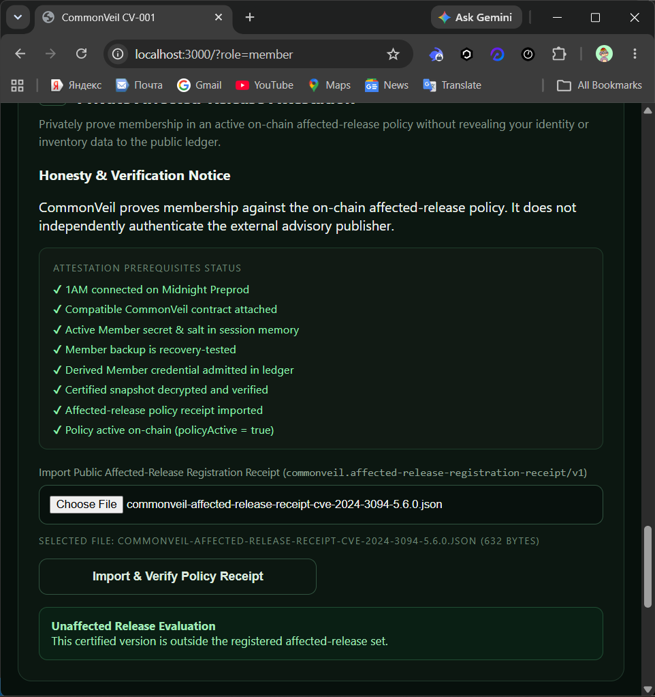
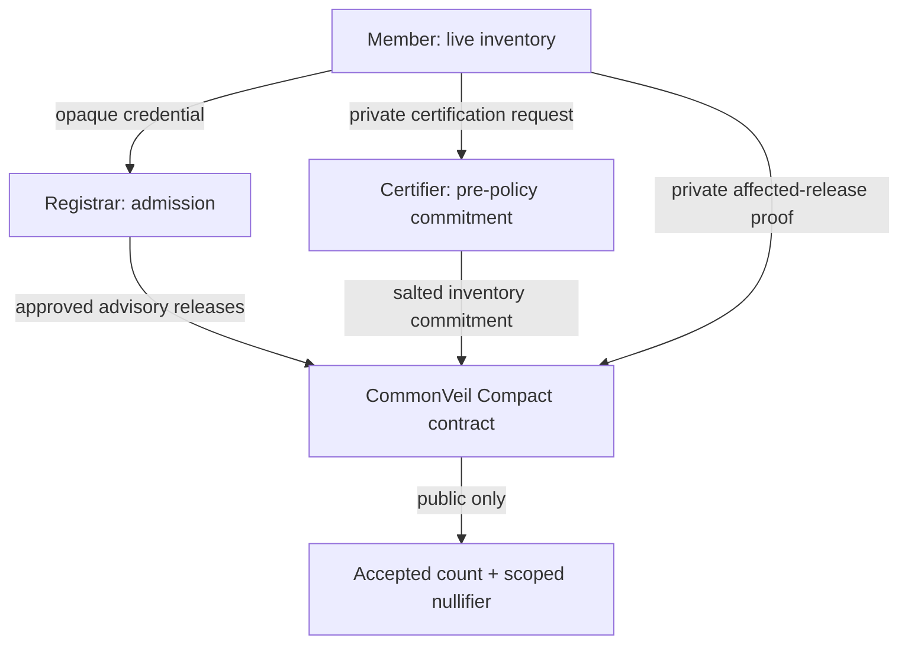

# CommonVeil

### Confidential vulnerability exposure coordination on Midnight

CommonVeil lets an organization prove that a previously certified private software inventory contains a registrar-approved affected release—without publishing the organization’s identity, complete inventory, or exact installed version.

Built with Compact and the Midnight JavaScript SDK for Midnight Preprod.

[Protocol architecture](docs/architecture.md) · [Preprod evidence](docs/evidence.md) · [Judge runbook](docs/demo-runbook.md) · [Threat model](docs/threat-model.md) · [Milestone status](docs/status.md)

> **Operational status:** The multi-role workflow has been exercised on Midnight Preprod through deployment, Member admission, pre-policy inventory certification, policy activation, encrypted evidence handoff, and final private evaluation. A genuine host running XZ Utils 5.2.5 was correctly classified as outside the registered 5.6.0 affected-release policy, so CommonVeil requested no attestation transaction.



## The problem

Vulnerability coordination creates a difficult disclosure trade-off.

An organization may need to demonstrate that it is affected by a critical software advisory, but publishing its identity together with an exact package inventory can reveal useful targeting information. A private statement alone has the opposite problem: regulators, coordinators, and ecosystem observers cannot verify that it satisfies the published policy or that it has not been counted twice.

CommonVeil separates the private fact from the public result:

- a **Registrar** admits opaque Member credentials and publishes exact affected releases;
- an independent **Certifier** commits a Member’s private inventory before the policy is activated;
- a **Member** later proves that the certified inventory matches the affected set; and
- an **Observer** sees the policy, commitments, advisory-scoped nullifiers, and aggregate accepted count—not the Member’s raw inventory.

## Why Midnight

CommonVeil is not a public application with privacy added at the interface. Its core authorization and affected-release checks execute inside Compact circuits.

| CommonVeil requirement | Midnight implementation |
|---|---|
| Keep the Member’s product and version private | They enter `attest` as private Compact circuit inputs and are not stored as ledger fields |
| Prove an exact affected-release match | Compact derives the private release commitment and checks membership in the public registrar-approved set |
| Prove that evidence existed before disclosure policy | `certifyInventory` accepts commitments only while `policyActive` is false |
| Separate operational authority | Registrar and Certifier actions require different secret-derived public keys |
| Prevent duplicate reports without naming the Member | `attest` inserts an advisory-scoped nullifier and rejects reuse |
| Preserve public accountability | The ledger exposes policy state and an aggregate `accepted` counter |
| Let the operator authorize real activity | 1AM supplies wallet connectivity, transaction balancing, approval, and submission on Preprod |

An ordinary public smart contract would require the product/version to be disclosed or trusted off-chain. CommonVeil uses Midnight so the contract can enforce the relationship between private inventory and public policy without publishing the inventory value.

## Thirty-second protocol view



1. The Member creates a secret-derived opaque credential and an encrypted backup.
2. The Registrar admits only that credential on Midnight.
3. A genuine host inventory report is packaged for the Certifier without its host fingerprint.
4. Before policy activation, the Certifier commits a salted inventory snapshot on-chain.
5. The Registrar registers an exact advisory/product/version tuple and activates the policy.
6. The Member privately evaluates the certified snapshot against that policy.
7. Only an affected match can produce an attestation; the same Member cannot attest twice for the same advisory.

## What CommonVeil proves

For an accepted private attestation, the Compact contract proves that:

- the credential was admitted by the Registrar;
- an authorized Certifier committed the same private inventory before policy activation;
- the private product and version match an exact registered affected release;
- the advisory-scoped Member nullifier has not already been used; and
- the aggregate accepted count may increase without publishing the Member credential or inventory value.

### What it does not claim

CommonVeil does not currently prove that every package on a host was scanned, that the scanner ran inside trusted hardware, or that separate browser workspaces represent legally independent organizations. The live scanner supplies honest package-manager provenance, not remote hardware attestation. A production deployment still needs authenticated scanner output, organizational enrollment rules, independent key custody, and a defined Certifier trust policy.

## Roles and workspaces

| Role | Private material | Authorized responsibility | Workspace |
|---|---|---|---|
| Registrar | Registrar secret | Deploy the contract, admit credentials, register affected releases | `/?role=registrar` |
| Certifier | Certifier secret, snapshot salt | Review genuine inventory evidence and commit a pre-policy snapshot | `/?role=certifier` |
| Member | Member secret, Member salt, certified snapshot | Scan, request certification, and privately evaluate exposure | `/?role=member` |
| Observer | None | Inspect public contract state and aggregate results | Any workspace’s public-state panel |

Selecting a workspace grants no authority. The Compact circuits verify the relevant secret-derived role key for every authorized state transition.

## Compact contract

The contract is deliberately small. Four circuits define the state-changing protocol:

| Circuit | Authorized caller | Core constraint | Public state change |
|---|---|---|---|
| `registerMember` | Registrar | Credential is new and Registrar secret matches `admin` | Inserts opaque Member credential |
| `certifyInventory` | Certifier | Credential is admitted, Certifier is authorized, policy is not active | Inserts salted inventory commitment |
| `registerAffectedRelease` | Registrar | Exact advisory/product/version release is new | Inserts release commitment and activates policy |
| `attest` | Member | Admission, certified snapshot, affected release, and unused nullifier all match | Inserts scoped nullifier and increments `accepted` |

Pure Compact circuits derive Registrar and Certifier keys, Member credentials, inventory commitments, release commitments, and advisory-scoped nullifiers using domain-separated persistent hashes.

## Privacy boundary

| Remains private or encrypted | Public on the Midnight ledger |
|---|---|
| Registrar and Certifier secrets | Derived Registrar and Certifier keys |
| Member secret and salt | Opaque admitted credentials |
| Snapshot salt | Salted inventory commitments |
| Product and exact installed version | Registered affected-release commitments |
| Complete inventory and host details | Policy activation flag |
| Backup passwords and encrypted package plaintext | Advisory-scoped used nullifiers |
| Organizational identity | Aggregate accepted count |

Private role packages use authenticated AES-256-GCM envelopes with PBKDF2-SHA-256 at 600,000 iterations. The browser requires a downloaded-backup recovery test before high-impact workflow exports or deployment actions become available. See [package boundaries](docs/package-boundaries.md) for the exact schemas and publication rules.

## Genuine Preprod evidence

CommonVeil preserves two separate evidence sets and never mixes their transaction identifiers.

### Positive protocol reference run

The earlier reference run used controlled XZ Utils 5.6.1 input to exercise the complete positive path. It is protocol evidence, not a claim about the test computer.

| Finalized operation | Midnight Preprod transaction ID |
|---|---|
| Contract deployment | `0044682865b940b3054c6fb1f065f4d19acc2627daa543dff4aaedbc88e8bcaf9c` |
| Member admission | `00ed9c0173c6dfa599c494f5cef901ea999e034c1e0d615cf658289ff7cc8af0ec` |
| Inventory certification | `00162a6cea69226e4731b519f76ca71e14e011eca434cfe2a08b88dda51f02f66b` |
| Register XZ Utils 5.6.0 | `00ddf48a2547cce14bb422981a1ebb69e7a7e94f275e2ba9b24ac6de8d555d58ea` |
| Register XZ Utils 5.6.1 | `00e7b17f940d9a156286ecfda8e222aa8604886774ca0c92a4f159457752591887` |
| Private affected-release attestation | `009c158f65b339b14130f7fc41fddc1735fad1acded068fcc429e23e6ec716ad47` |

Final public state recorded `accepted = 1`, one used nullifier, and no published inventory value.

### Genuine live-host operational run — 2026-10-14

| Field | Recorded evidence |
|---|---|
| Network | Midnight Preprod |
| Contract | `b62b97709f7629cede3bcbcd52ecda4fe2ad204ceac2946fda484789d104d23b` |
| Provenance | `live-host-scan` |
| Product | `pkg:generic/xz-utils` |
| Observed package | `5.2.5-2ubuntu1.1` |
| Normalized version | `5.2.5` |
| Registered policy | `CVE-2024-3094` / XZ Utils `5.6.0` |
| Result | Unaffected; no attestation requested or submitted |

The negative result is intentional and important: CommonVeil did not change the observed version or manufacture a positive exposure claim for the demonstration. The [full evidence manifest](docs/evidence/live-preprod-2026-10-14/README.md) records what was captured and explicitly marks identifiers that were not retained.

## Technology

- **Midnight Compact** — circuit and ledger-state enforcement
- **Midnight JavaScript SDK 4.1.1** — deployment, calls, providers, and finalized transaction handling
- **Midnight ledger v8.1.0** — transaction and ledger types
- **1AM wallet / Connector API v4** — Preprod account connection and operator approval
- **Midnight proof server 8.1.0 or wallet prover** — zero-knowledge proving
- **Midnight Preprod indexer** — public contract-state queries; validated Blockfrost overrides are supported
- **React 19 + TypeScript + Vite** — role-separated browser application
- **Node test runner + TSX** — contract, package, provider, scanner, and state-machine regression tests

## Run locally

### Requirements

- Linux or WSL2
- Node.js 22 or newer
- Docker
- Compact compiler `0.31.1`
- Chrome with a Connector API v4-compatible 1AM wallet configured for Midnight Preprod
- Preprod NIGHT and available DUST for state-changing transactions

Install Compact using the official Midnight toolchain, then pin the compiler:

```sh
compact update 0.31.1
```

### Install and verify

```sh
git clone https://github.com/0xaje/CommonVeil.git
cd CommonVeil
npm ci
npm run verify
```

`npm run verify` performs the environment check, compiles all four Compact circuits without skip flags, executes the automated test suites, type-checks the application, and produces the Vite bundle.

### Start a local proof server

```sh
docker run --name commonveil-proof-server \
  -p 127.0.0.1:6300:6300 \
  midnightntwrk/proof-server:8.1.0 \
  midnight-proof-server -v
```

Verify it separately:

```sh
curl http://localhost:6300/health
```

The application prefers the wallet’s proving provider. It falls back to the configured or local HTTP proof server when the wallet prover is unavailable.

### Configure the Preprod indexer when required

CommonVeil normally uses the indexer configuration supplied by 1AM. If that endpoint is unavailable, copy `.env.example` to an untracked `.env` file and supply a valid paired Midnight Preprod Blockfrost HTTPS/WSS configuration. The application rejects incomplete pairs, placeholder credentials, unsafe protocols, and unexpected hosts. Never commit the resulting `.env` file or expose its project token.

### Start the application

```sh
npm run dev
```

Open [http://localhost:3000](http://localhost:3000). The product overview is at `/`; the three operational workspaces use the role URLs listed above.

## Generate genuine inventory evidence

Run the scanner inside the Linux or WSL environment whose package inventory should be measured:

```sh
npm run --silent scan:json > inventory-report.json
```

The scanner queries the host package manager and then the installed `xz` binary. It:

- labels successful evidence `live-host-scan`;
- retains the observed raw version and a normalized tuple;
- understands Debian/Ubuntu `+really` rollback packages;
- calculates a SHA-256 measurement digest;
- exits with code `2` rather than inventing a version when XZ is not detected; and
- excludes host fingerprint and machine details from the exported Certifier request.

This is genuine host measurement, but not a signed or hardware-attested measurement.

## Verify the repository

```sh
npm run doctor       # Node, Compact, and Docker checks
npm run compile      # Generate Compact bindings, ZK keys, and ZK-IR
npm test             # Contract and application regression tests
npm run build        # TypeScript check and production bundle
npm run scan         # Human-readable genuine host scan
```

The tests execute compiler-generated Compact circuit logic locally. They verify the protocol and negative paths without submitting live transactions; they are not presented as network proofs. Live-network claims are supported separately by the Preprod evidence above.

## Repository map

```text
CommonVeil/
├── contracts/
│   ├── commonveil.compact          # Four-circuit privacy protocol
│   └── managed/commonveil/         # Generated contract, keys, and ZK-IR
├── src/
│   ├── RoleWorkspace.tsx           # Registrar, Certifier, and Member operations
│   ├── contract-session.ts         # Read-only inspection and verified attachment
│   ├── providers.ts                # 1AM, prover, indexer, and submission providers
│   ├── role-packages.ts            # Typed packages and encrypted envelopes
│   └── role-workspace-state.ts     # Pure workflow state and safety gates
├── scripts/
│   ├── doctor.mjs                  # Toolchain checks
│   └── scan-inventory.mjs          # Genuine XZ host measurement
├── tests/                          # Compact, scanner, package, provider, and UI-state tests
├── docs/
│   ├── architecture.md
│   ├── demo-runbook.md
│   ├── evidence.md
│   ├── package-boundaries.md
│   ├── threat-model.md
│   └── status.md
├── .env.example                    # Credential-free indexer configuration template
└── README.md
```

## Security notes

- Never upload or commit wallet recovery phrases, role secrets, package plaintext, backup passwords, private inventory, or Blockfrost credentials.
- Role secrets live only in volatile browser-session memory. CommonVeil overwrites its active byte arrays during lifecycle resets, while acknowledging that JavaScript cannot guarantee complete garbage-collected memory scrubbing.
- Restored encrypted backups cannot reveal or copy the underlying secret through the interface.
- Contract addresses and transaction IDs are validated and kept as distinct values.
- User-facing errors are sanitized so provider URLs, local paths, tokens, and raw cryptographic errors are not displayed.
- Selecting a role in the interface is not authorization; Compact circuit checks remain authoritative.

For assumptions, adversaries, residual risks, and non-goals, read the [threat model](docs/threat-model.md).

## Current limitations and next steps

- Authenticate scanner output and bind it to a device or organizational root of trust.
- Establish production enrollment and independent Certifier governance.
- Extend the deliberately narrow exact-release policy to reviewed version-range semantics.
- Add continuous end-to-end monitoring across wallet, prover, indexer, and network upgrades.
- Complete an isolated genuinely affected-host Preprod run without weakening the existing honesty boundary.
- Publish the final demonstration video and submission presentation.

## Documentation

- [Architecture and circuit flow](docs/architecture.md)
- [Threat model and claim boundary](docs/threat-model.md)
- [Package boundaries and disclosure rules](docs/package-boundaries.md)
- [Verified Midnight Preprod evidence](docs/evidence.md)
- [2026-10-14 live operational evidence](docs/evidence/live-preprod-2026-10-14/README.md)
- [Judge demonstration runbook](docs/demo-runbook.md)
- [Measured milestone history](docs/status.md)
- [Buildathon pitch deck](docs/pitch/CommonVeil-Midnight-Buildathon-Deck.pptx)
- [Buildathon submission draft](docs/buildathon-submission.md)
- [Submission checklist](docs/submission-checklist.md)

## Advisory references

- [XZ Utils upstream advisory](https://tukaani.org/xz-backdoor/)
- [Red Hat CVE-2024-3094 advisory](https://access.redhat.com/security/cve/cve-2024-3094)
- [Midnight support matrix](https://docs.midnight.network/relnotes/support-matrix)
- [Midnight deployment and operations guide](https://docs.midnight.network/guides/deploy-and-operate)

## License

CommonVeil is available under the [Apache License 2.0](LICENSE).
