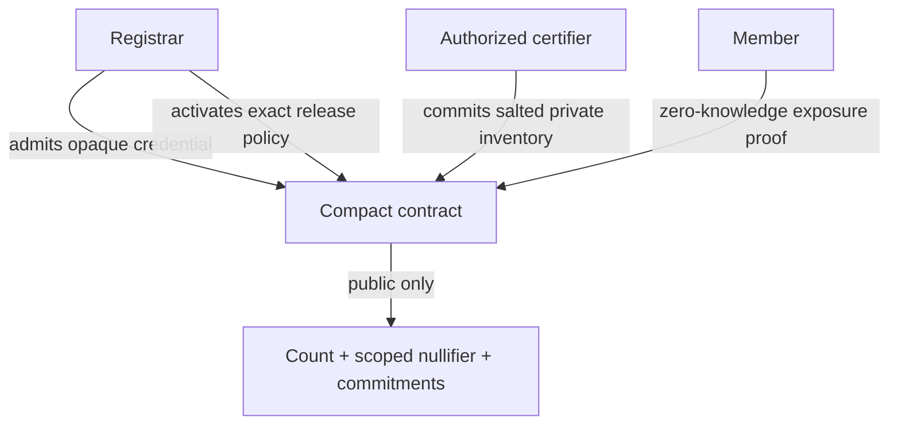

# CommonVeil architecture

## Purpose

CommonVeil coordinates vulnerability exposure without publishing a member identity or inventory value. CV-005 demonstrates one deliberately narrow policy: an admitted member has a certifier-originated inventory snapshot for XZ Utils 5.6.0 or 5.6.1, and can report once for CVE-2024-3094.

## Roles

| Role | Private material | Authorized action |
|---|---|---|
| Registrar | `adminSecret` | Admit opaque member credentials and register exact affected releases |
| Certifier | `certifierSecret` | Create a salted inventory commitment for an admitted credential before policy activation |
| Member | `memberSecret`, `memberSalt`, `snapshotSalt`, product/version | Prove the certified snapshot matches an affected release |
| Observer | None | Read public counts, commitments, nullifiers, and submitted transaction IDs |

The operational interface provides separate Registrar, Certifier, and Member workspaces. Role secrets are cryptographically distinct and exchanged data is constrained by typed packages, but a single operator exercising the three workspaces is not evidence of organizational or device isolation.

## Contract state

Public ledger state contains:

- derived registrar and certifier keys;
- opaque admitted-member credentials;
- salted inventory commitments;
- exact affected-release commitments;
- advisory-scoped used nullifiers;
- the accepted-report counter; and
- the policy activation flag.

Raw secrets, snapshot salt, product, version, and member identity are not stored as ledger fields.

## Circuit sequence

1. `registerMember` checks the registrar secret and inserts an opaque credential.
2. `certifyInventory` checks the certifier secret, admitted credential, and open certification window, then inserts a salted inventory commitment.
3. `registerAffectedRelease` checks the registrar secret, inserts an exact advisory/product/version commitment, and closes certification.
4. `attest` proves membership, certified snapshot membership, affected-release membership, and unused advisory-scoped nullifier before incrementing `accepted`.

## Privacy and integrity properties

- Exact product/version matching is constrained inside Compact.
- A member cannot create a certified snapshot with only its membership secret.
- A snapshot cannot be certified after policy activation.
- The same member secret cannot report twice for the same advisory.
- The same member can report for a different registered advisory.
- Successful proof reveals affected-set membership, not the exact private release within that small public set.

## Multi-role package boundaries and receipts (CV-006 through CV-011)

Out-of-band communication between roles is partitioned into strictly typed packages:
- `commonveil.certifier-key/v1`: Certifier public key package.
- `commonveil.member-admission/v1`: Restricted credential admission package.
- `commonveil.certification-request/v1`: Private inventory measurement request.
- `commonveil.certified-snapshot/v1`: Private certified snapshot package containing `snapshotSalt`.
- `commonveil.encrypted-envelope/v1`: AES-256-GCM / PBKDF2-SHA-256 (600,000 iterations) envelope for private packages.
- `commonveil.affected-release-registration-receipt/v1`: Public affected-release registration receipt.
- `commonveil.private-attestation-receipt/v1`: Public attestation receipt containing only safe, non-linking transaction and scope fields.

## Operational status

The 2026-10-14 Preprod run completed the multi-role flow through final evaluation. Because the genuine host measured XZ Utils 5.2.5 and the active policy registered 5.6.0, the Member was correctly classified as unaffected and no attestation transaction was created. The positive attestation path remains covered by authentic generated Compact circuit execution and the earlier CV-005 Preprod reference run.

See [threat-model.md](threat-model.md) for non-goals and residual risks.
