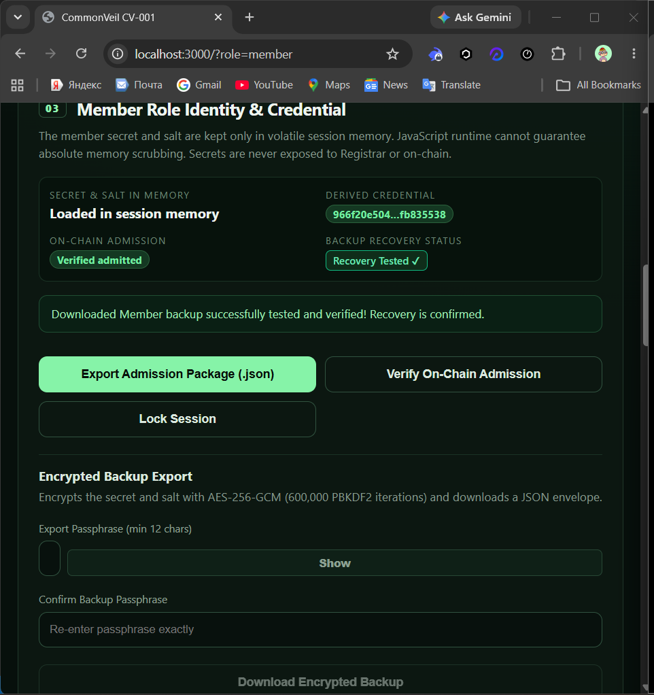
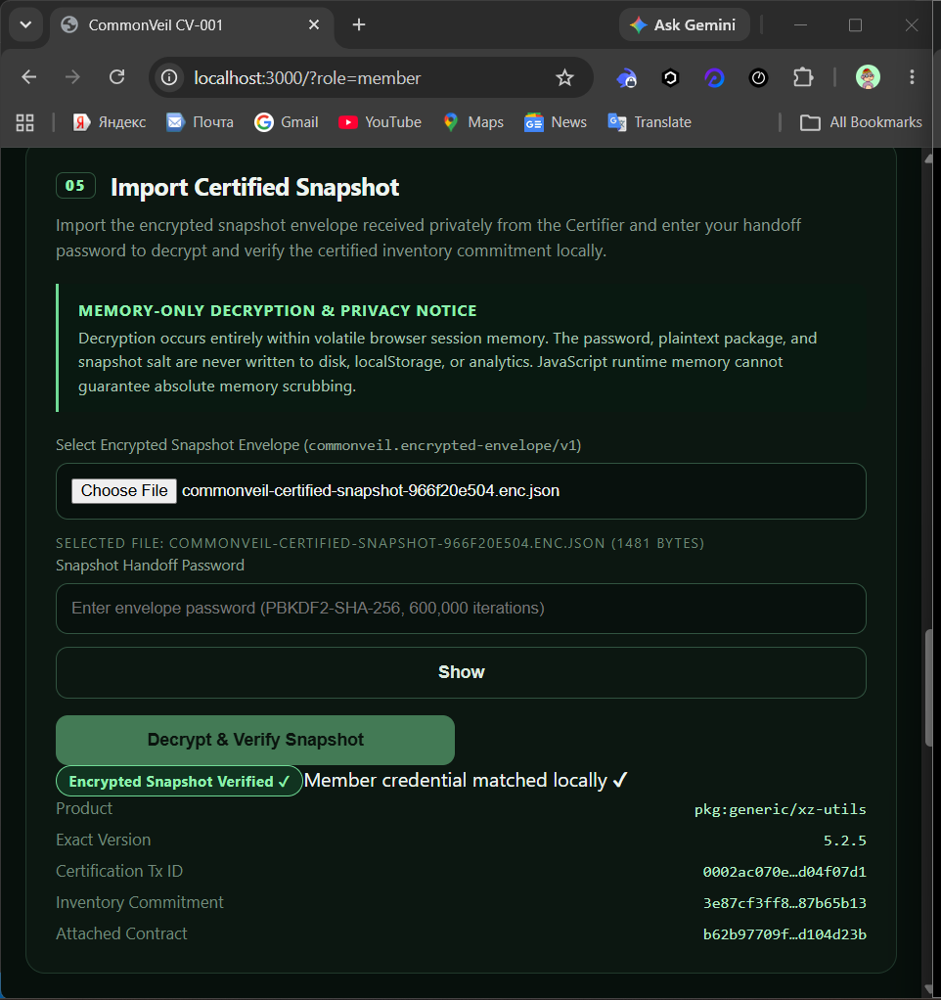
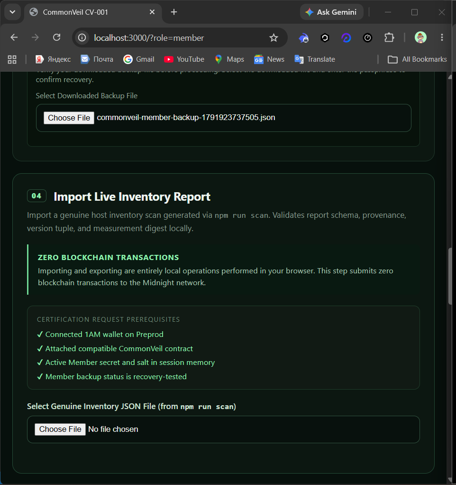

# Live Preprod operational evidence — 2026-10-14

## Scope

This directory records the genuine multi-role negative-result run. It does not replace or reuse the earlier CV-005 positive reference transaction IDs.

| Field | Recorded value |
|---|---|
| Network | Midnight Preprod |
| Contract address | `b62b97709f7629cede3bcbcd52ecda4fe2ad204ceac2946fda484789d104d23b` |
| Inventory provenance | `live-host-scan` |
| Product | `pkg:generic/xz-utils` |
| Raw version | `5.2.5-2ubuntu1.1` |
| Normalized version | `5.2.5` |
| Measurement digest | `e1d39a145e334c3664c1128f45d915c446dd3b718a6867d0fb23262778d25483` |
| Registered policy | `CVE-2024-3094` / `pkg:generic/xz-utils` / `5.6.0` |
| Evaluation | Unaffected: certified 5.2.5 is outside the registered 5.6.0 set |
| Attestation transaction | None — correctly blocked before submission |

## Transaction evidence boundary

| Operation | Current-run evidence |
|---|---|
| Contract deployment | Completed; SDK did not expose a transaction ID in the captured deployment receipt |
| Member admission | Completed; full transaction ID not captured in the supplied artifacts |
| Inventory certification | Completed; UI shows a genuine finalized ID, but the supplied screenshot truncates it, so the full ID is not captured here |
| Affected-release registration | Completed; full transaction ID not captured in the supplied artifacts |
| Private attestation | No transaction exists for this run |

The contract address must never be substituted for a transaction ID. Earlier CV-005 transaction IDs in `docs/evidence.md` belong to a different run.

## Screenshot manifest

### `01-member-identity-verified.png`

Shows the Member secret and salt loaded in volatile session memory, derived credential, `Verified admitted` on-chain status, `Recovery Tested`, and the explicit read-only verification action.

### `02-certified-snapshot-verified.png`

Shows successful encrypted snapshot decryption, local Member credential match, product `pkg:generic/xz-utils`, exact version 5.2.5, certification transaction prefix, commitment prefix, and attached contract prefix.

### `03-live-inventory-prerequisites.png`

Shows that the Member workspace had a connected Preprod wallet, compatible attached contract, active identity, and recovery-tested backup. “No file chosen” reflects the later read-only screenshot state; it does not claim a new import.

### `04-unaffected-evaluation.png`

Shows every final prerequisite checked, including derived credential admission, verified snapshot, imported policy receipt, and active on-chain policy. It records the honest result: `This certified version is outside the registered affected-release set.`

## Interpretation

This is a successful negative protocol result. The system did not request 1AM approval for `attest`, did not insert a nullifier, and did not increment `accepted` for this evaluation. A positive live-host demonstration would require an actually affected isolated environment whose snapshot is certified before policy activation.
